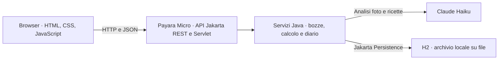

# DASS · Diario alimentare da una foto

**DASS è un prototipo didattico per registrare ciò che mangi a partire da una foto.** Propone gli ingredienti e le quantità di una porzione, ti permette di correggerli e salva il pasto con i suoi valori nutrizionali.

[Come funziona](#come-funziona) · [Schermate](#schermate) · [Architettura](#architettura) · [Avvio locale](#avvio-locale) · [Versione GitHub Pages](#versione-github-pages)

## Come funziona

Al ristorante spesso conosci il nome del piatto, ma sai poco dei singoli ingredienti e delle loro quantità. DASS usa la foto, una descrizione facoltativa e ricette reperibili online per preparare una prima stima da verificare.

1. **Carica una foto.** Scegli un JPEG o PNG fino a 5 MiB e aggiungi, se utile, il nome del piatto o una descrizione della porzione.
2. **Controlla la proposta.** Claude Haiku suggerisce gli ingredienti e stima i grammi di una porzione. DASS propone le schede del catalogo nutrizionale. Puoi correggere nomi, quantità e abbinamenti.
3. **Registra il pasto.** Controlla carboidrati, proteine, grassi ed energia nell’anteprima. Lo storico conserva la foto, gli ingredienti e i valori salvati al momento della registrazione.

La simulazione dell’insulina usa un profilo sintetico ed è destinata alla dimostrazione didattica.

## Schermate

### Homepage

Da qui puoi avviare una nuova analisi, aprire lo storico o consultare catalogo e API.


### Caricamento di un piatto

Il modulo mostra l’anteprima della foto e permette di aggiungere una descrizione prima dell’invio a Haiku.


### Storico dei pasti

I pasti registrati sono ordinati dal più recente. Ogni scheda mostra i totali nutrizionali e permette di aprire il dettaglio degli ingredienti e delle quantità.


## Architettura

Le pagine web e le API REST sono distribuite nello stesso file WAR su Payara Micro. Il backend coordina la proposta di Haiku, il calcolo con i valori del catalogo e il salvataggio in H2.



| Componente | Ruolo e percorso |
| --- | --- |
| Frontend | Pagine, stili e JavaScript in [`src/main/webapp/`](src/main/webapp/) |
| Backend | Java 21 e Jakarta EE 10. Endpoint e servizi in [`src/main/java/it/unisi/dass/`](src/main/java/it/unisi/dass/) |
| Persistenza | Jakarta Persistence con EclipseLink e H2. L’archivio predefinito è `var/demo/dass.mv.db` |
| Catalogo | Schede in italiano basate su USDA Foundation Foods, con integrazioni. File [`catalogo_nutrizionale_it.json`](macros_tables/catalogo_nutrizionale_it.json) |
| API | Contratto [OpenAPI](src/main/webapp/openapi.json), consultabile e provabile in [Swagger UI](http://127.0.0.1:8080/dass/swagger.html) a server avviato |

Il database distingue il **piatto** (per esempio «Fusilli al pomodoro») dall’**episodio** (una porzione mangiata in un dato momento). Puoi registrare due porzioni dello stesso piatto e ritrovare entrambe nello storico con quantità e valori propri.

## Avvio locale

### Prima installazione su Windows

Servono **Windows x64**, **PowerShell 5.1 o successivo**, una cartella scrivibile e una connessione Internet per il primo avvio. La procedura è stata verificata con PowerShell 7.

1. Clona il repository o scaricalo da GitHub con **Code → Download ZIP** e decomprimilo.
2. Apri PowerShell nella cartella che contiene `pom.xml` ed esegui il comando seguente.

   ```powershell
   .\Installa-DASS.ps1 -Avvia
   ```

3. Attendi il completamento del deploy, poi apri il [diario locale](http://127.0.0.1:8080/dass/). Nello storico trovi già cinque pasti dimostrativi.

Lo script [Installa-DASS.ps1](Installa-DASS.ps1) scarica e verifica **OpenJDK 21**, **Maven** e **Payara Micro** in `.dass-tools/`, quindi compila `target/dass.war`. H2 è incluso in Payara Micro e crea `var/demo/dass.mv.db` al primo avvio. Gli strumenti sono installati nella cartella del progetto e vengono riutilizzati alle esecuzioni successive.

### Compilazione e riavvio

- Usa `.\Installa-DASS.ps1` per installare e compilare senza avviare il server.
- Se la porta 8080 è occupata, usa `.\Installa-DASS.ps1 -Avvia -Porta 8081` e apri [il diario sulla porta 8081](http://127.0.0.1:8081/dass/).
- Premi **Ctrl+C** nella finestra del server per fermarlo. Se il WAR è già compilato, questi comandi preparano una nuova finestra PowerShell e riavviano il server con lo stesso archivio.

  ```powershell
  .\Prepara-DASS.ps1
  .\scripts\Avvia-DASS.ps1
  ```

### Analisi delle foto

Per abilitare l’analisi, esegui `.\scripts\Salva-ChiaveHaiku.ps1`, inserisci la tua chiave Anthropic nel prompt mascherato e riavvia Payara. La ricerca delle ricette richiede **Web search** abilitato per l’organizzazione Anthropic. Il diario e lo storico dimostrativo sono disponibili anche senza chiave.

Per configurazione, contratti REST e collaudi, consulta la [guida tecnica](docs/guida-tecnica.md).

Il [manuale HTML](DASS_Manuale_Progetto.html) descrive anche le tabelle H2, le relazioni tra i dati e i contratti delle API.

## Versione GitHub Pages

La cartella [`github-pages/`](github-pages/) contiene la versione statica del prototipo, pubblicabile su GitHub Pages senza Payara. Le pagine sono quelle del diario. Le API REST rispondono direttamente nel browser, con gli stessi percorsi e lo stesso JSON descritti in [OpenAPI](src/main/webapp/openapi.json), e salvano bozze, pasti e foto in IndexedDB, solo sul dispositivo di chi visita il sito.

- **Dati dimostrativi.** Al primo accesso il browser carica la stessa fixture del backend: profilo sintetico, due piatti e cinque pasti. La home permette di ripristinarla.
- **Analisi delle foto.** Senza chiave la foto apre una bozza da compilare a mano, mentre **Usa la foto di esempio** riceve una proposta già pronta. Con una chiave Anthropic inserita nella pagina di analisi il browser chiama Haiku direttamente: la chiave resta nel browser e viene inviata solo ad `api.anthropic.com`.
- **JSON e Swagger UI.** I collegamenti alle API aprono [`api.html`](github-pages/api.html), che mostra la risposta di ogni `GET`. In Swagger UI, **Try it out** usa l'API nel browser.

Lo script [Costruisci-Pages.ps1](scripts/Costruisci-Pages.ps1) prepara il sito in `_site/`. Copia le pagine del prototipo da `src/main/webapp/`, sovrascrive i file adattati di `github-pages/` e aggiunge catalogo, schema dello strumento Haiku e foto della fixture. Per provarlo in locale:

```powershell
.\scripts\Avvia-Pages.ps1
```

Poi apri [l'anteprima](http://localhost:8090/). Il workflow [pages.yml](.github/workflows/pages.yml) esegue lo stesso script e pubblica il sito a ogni push su `main`. Per attivarlo la prima volta, un amministratore del repository sceglie **Settings → Pages → Build and deployment → Source: GitHub Actions**. Il sito sarà su <https://bevospuma43.github.io/dass_progetto/>.
