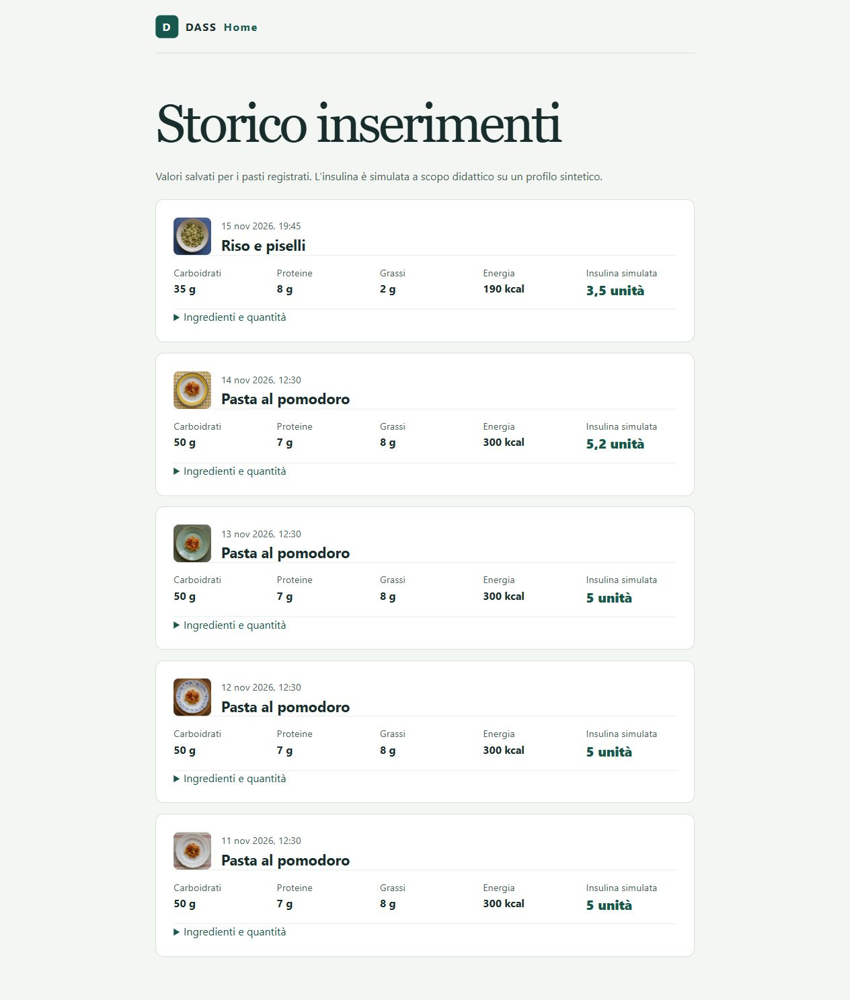
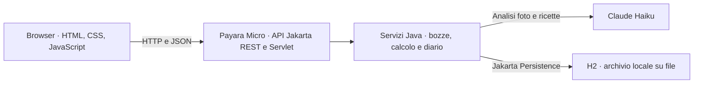

# DASS · Diario alimentare da una foto

**DASS è un prototipo didattico per registrare ciò che mangi a partire da una foto.** Propone gli ingredienti e le quantità di una porzione, ti permette di correggerli e salva il pasto con i suoi valori nutrizionali.

[Come funziona](#come-funziona) · [Schermate](#schermate) · [Architettura](#architettura) · [Avvio locale](#avvio-locale)

## Come funziona

Al ristorante spesso conosci il nome del piatto, ma sai poco dei singoli ingredienti e delle loro quantità. DASS usa la foto, una descrizione facoltativa e ricette reperibili online per preparare una prima stima da verificare.

1. **Carica una foto.** Scegli un JPEG o PNG fino a 5 MiB e aggiungi, se utile, il nome del piatto o una descrizione della porzione.
2. **Controlla la proposta.** Claude Haiku suggerisce gli ingredienti e stima i grammi di una porzione. DASS propone le schede del catalogo nutrizionale. Puoi correggere nomi, quantità e abbinamenti.
3. **Registra il pasto.** Controlla carboidrati, proteine, grassi ed energia nell’anteprima. Lo storico conserva la foto, gli ingredienti e i valori salvati al momento della registrazione.

La simulazione dell’insulina usa un profilo sintetico ed è destinata alla dimostrazione didattica.

## Schermate

### Homepage

Da qui puoi avviare una nuova analisi, aprire lo storico o consultare catalogo e API.


### Caricamento di un piatto

Il modulo mostra l’anteprima della foto e permette di aggiungere una descrizione prima dell’invio a Haiku.


### Storico dei pasti

I pasti registrati sono ordinati dal più recente. Ogni scheda mostra i totali nutrizionali e permette di aprire il dettaglio degli ingredienti e delle quantità.



## Architettura

Le pagine web e le API REST sono distribuite nello stesso file WAR su Payara Micro. Il backend coordina la proposta di Haiku, il calcolo con i valori del catalogo e il salvataggio in H2.



| Componente | Ruolo e percorso |
| --- | --- |
| Frontend | Pagine, stili e JavaScript in [`src/main/webapp/`](src/main/webapp/) |
| Backend | Java 21 e Jakarta EE 10. Endpoint e servizi in [`src/main/java/it/unisi/dass/`](src/main/java/it/unisi/dass/) |
| Persistenza | Jakarta Persistence con EclipseLink e H2. L’archivio predefinito è `var/demo/dass.mv.db` |
| Catalogo | Schede in italiano basate su USDA Foundation Foods, con integrazioni. File [`catalogo_nutrizionale_it.json`](macros_tables/catalogo_nutrizionale_it.json) |
| API | Contratto [OpenAPI](src/main/webapp/openapi.json), consultabile e provabile in [Swagger UI](http://127.0.0.1:8080/dass/swagger.html) a server avviato |

Il database distingue il **piatto** (per esempio «Fusilli al pomodoro») dall’**episodio** (una porzione mangiata in un dato momento). Puoi registrare due porzioni dello stesso piatto e ritrovare entrambe nello storico con quantità e valori propri.

## Avvio locale

Dalla radice del progetto, in Windows PowerShell, prepara Java, Maven e Payara, quindi compila e avvia.

```powershell
.\Prepara-DASS.ps1
mvn verify
if ($LASTEXITCODE -eq 0) { .\scripts\Avvia-DASS.ps1 }
```

Apri il [diario locale](http://127.0.0.1:8080/dass/). Lo storico contiene già pasti dimostrativi.

Per usare l’analisi delle foto, configura la chiave Anthropic con `.\scripts\Salva-ChiaveHaiku.ps1` e riavvia Payara. La ricerca di ricette richiede la funzione Web search abilitata per l’organizzazione Anthropic.

Per configurazione, contratti REST e collaudi, consulta la [guida tecnica](docs/guida-tecnica.md).

Il [manuale HTML](DASS_Manuale_Progetto.html) descrive anche le tabelle H2, le relazioni tra i dati e i contratti delle API.
