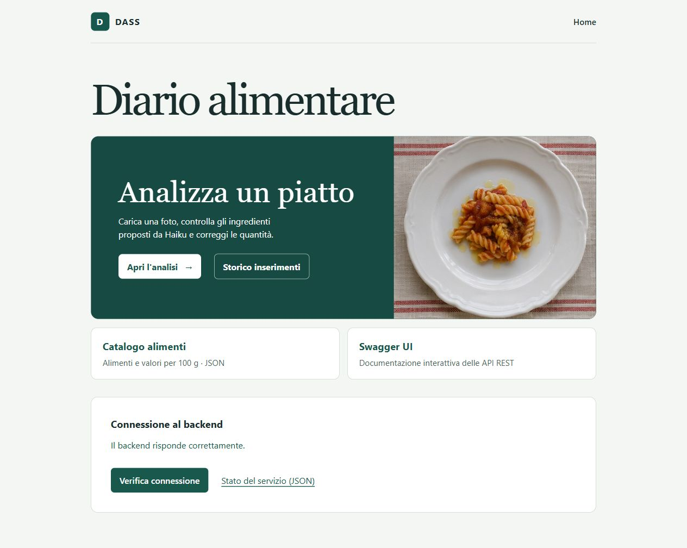
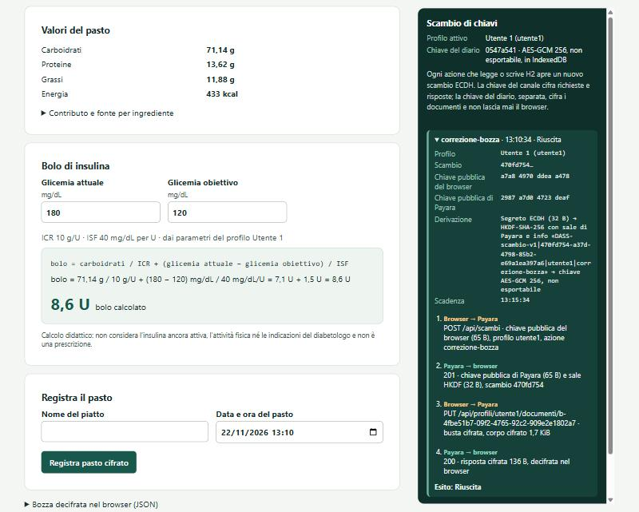
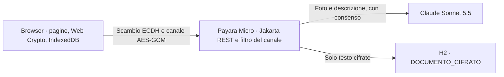

# DASS · Diario alimentare da una foto

**DASS è un prototipo didattico per registrare ciò che mangi a partire da una foto e calcolare il bolo di insulina del pasto.** Propone ingredienti e quantità di una porzione, ti permette di correggerli, calcola carboidrati e bolo e salva il pasto in un diario cifrato nel browser.

[Come funziona](#come-funziona) · [Sicurezza](#sicurezza) · [Schermate](#schermate) · [Architettura](#architettura) · [Avvio locale](#avvio-locale) · [Collaudi](#collaudi)

## Come funziona

1. **Imposta i parametri.** Nella Home scegli il profilo (`utente1` o `utente2`) e inserisci ICR, ISF e glicemia obiettivo (predefinita 120 mg/dL).
2. **Carica un piatto.** Scegli un JPEG o PNG fino a 5 MiB, aggiungi una descrizione facoltativa, la glicemia attuale e quella obiettivo, e dai il consenso all’invio di foto e descrizione per l’analisi.
3. **Controlla la proposta.** Claude Sonnet 5.5 suggerisce gli ingredienti e stima i grammi della porzione, anche cercando ricette online. Per ogni ingrediente Claude sceglie anche la scheda del catalogo nutrizionale; puoi correggere nomi, quantità e schede.
4. **Calcola e registra.** Il browser calcola carboidrati, proteine, grassi, energia e il bolo con la formula

   ```text
   bolo = carboidrati / ICR + (glicemia attuale − glicemia obiettivo) / ISF
   ```

   e salva il pasto cifrato. Lo storico conserva foto, ingredienti, valori e bolo del momento della registrazione.

Il bolo è un calcolo didattico: non considera l’insulina ancora attiva né le indicazioni del diabetologo e non è una prescrizione. Con glicemia sotto 70 mg/dL il prototipo non calcola un bolo.

## Sicurezza

- **Chiave del diario per profilo.** Il browser genera per ogni profilo una chiave AES-GCM a 256 bit non esportabile e la conserva in IndexedDB. Pasti, ingredienti, valori nutrizionali, parametri, bozze, foto e miniature vengono cifrati prima di lasciare la pagina. Payara conserva in H2 solo testo cifrato e metadati minimi (profilo, id, tipo, revisione, data).
- **Scambio di chiavi per ogni azione.** Ogni azione che legge o scrive H2 (apertura dello storico, caricamento, correzione della bozza, salvataggio…) apre uno scambio ECDH P-256 con Payara. Dalla chiave condivisa HKDF-SHA-256 deriva la chiave del canale, che cifra ogni richiesta e risposta dell’azione, miniature comprese. La chiave del canale è distinta da quella del diario.
- **Consenso per l’analisi.** Foto e descrizione raggiungono Payara, e tramite Payara Anthropic, solo con il consenso esplicito nel modulo. Payara non le salva: la bozza viene salvata dal browser dopo la cifratura.
- **Cambio di profilo.** Lo schermo si svuota, le richieste aperte vengono interrotte e le risposte arrivate in ritardo non mostrano i dati del profilo precedente.
- **Pannello «Scambio di chiavi».** Ogni pagina mostra profilo attivo, direzione dei messaggi, impronte delle chiavi pubbliche, derivazione ed esito di ogni scambio. Nello storico, la sezione **Archivio H2** mostra i record così come li conserva il server e prova ad aprirli con la chiave del profilo attivo.

I limiti del prototipo sono descritti nella [guida tecnica](docs/guida-tecnica.md#limiti-noti): in particolare la scelta del profilo non è un’autenticazione e lo scambio ECDH non autentica il server.

## Schermate

### Home

Profilo attivo, parametri del bolo, bozze da completare e pannello degli scambi di chiavi.



### Analisi del piatto e bolo

Dopo il calcolo il browser mostra i valori del pasto e la formula del bolo con i valori sostituiti.



### Storico e archivio H2

I pasti vengono decifrati nel browser. La vista dell’archivio H2 mostra il testo cifrato di tutti i profili e l’esito della prova di decifratura con la chiave del profilo attivo.


## Architettura

Pagine web e API REST sono distribuite nello stesso WAR su Payara Micro. Le regole del diario (bozze, totali, bolo) girano nel browser; Payara inoltra l’analisi a Claude e conserva i documenti cifrati.



| Componente | Ruolo e percorso |
| --- | --- |
| Frontend | Pagine, stili e moduli JavaScript in [`src/main/webapp/`](src/main/webapp/). Crittografia in [`js/sicurezza/`](src/main/webapp/js/sicurezza/), logica del diario in [`js/logica/`](src/main/webapp/js/logica/) |
| Backend | Java 21 e Jakarta EE 10 in [`src/main/java/it/unisi/dass/`](src/main/java/it/unisi/dass/): `api`, `sicurezza`, `persistenza`, `analisi` |
| Persistenza | Jakarta Persistence con EclipseLink e H2. Archivio predefinito `var/dati/dass.mv.db` |
| Catalogo | 465 schede in italiano da USDA (Foundation Foods e SR Legacy) e CREA, con i carboidrati disponibili (fibra esclusa) usati per il bolo. File [`catalogo_nutrizionale_it.json`](macros_tables/catalogo_nutrizionale_it.json) |
| API | Contratto [OpenAPI](src/main/webapp/openapi.json), consultabile in [Swagger UI](http://127.0.0.1:8080/dass/swagger.html) a server avviato |

## Avvio locale

### Prima installazione su Windows

Servono **Windows x64**, **PowerShell 5.1 o successivo**, una cartella scrivibile e una connessione Internet per il primo avvio.

1. Clona il repository o scaricalo da GitHub con **Code → Download ZIP** e decomprimilo.
2. Apri PowerShell nella cartella che contiene `pom.xml` ed esegui:

   ```powershell
   .\Installa-DASS.ps1 -Avvia
   ```

3. Attendi il completamento del deploy, poi apri il [diario locale](http://127.0.0.1:8080/dass/). I profili `utente1` e `utente2` partono con il diario vuoto.

Lo script [Installa-DASS.ps1](Installa-DASS.ps1) scarica e verifica **OpenJDK 21**, **Maven** e **Payara Micro** in `.dass-tools/`, quindi compila `target/dass.war`. H2 è incluso in Payara Micro e crea `var/dati/dass.mv.db` al primo avvio. Un archivio della versione precedente in `var/demo` viene spostato in `var/dati` e ripulito dai dati di `paz-demo`.

### Compilazione e riavvio

- `.\Installa-DASS.ps1` installa e compila senza avviare il server.
- Se la porta 8080 è occupata: `.\Installa-DASS.ps1 -Avvia -Porta 8081`, poi apri [il diario sulla porta 8081](http://127.0.0.1:8081/dass/).
- Per fermare il server premi **Ctrl+C** nella sua finestra. Per ricompilare e riavviare in una nuova PowerShell:

  ```powershell
  .\Prepara-DASS.ps1
  mvn clean verify
  .\scripts\Avvia-DASS.ps1
  ```

  Usa sempre `clean`: senza, nel WAR possono restare classi di versioni precedenti.

### Analisi delle foto

Esegui `.\scripts\Salva-ChiaveClaude.ps1`, inserisci la chiave Anthropic nel prompt mascherato e riavvia Payara. La ricerca delle ricette richiede **Web search** abilitato per l’organizzazione Anthropic. Senza chiave l’analisi non è disponibile, ma la foto viene comunque salvata cifrata e puoi compilare gli ingredienti a mano.

## Collaudi

Dopo `mvn clean verify`, in una PowerShell preparata:

| Script | Cosa verifica |
| --- | --- |
| `.\scripts\Verifica-Sicurezza.ps1` | HKDF (vettori RFC 5869), scambio ECDH, buste valide, ripetute, alterate o scadute, punti fuori curva |
| `.\scripts\Verifica-Persistenza.ps1` | Rimozione di `paz-demo`, profili, documenti cifrati, revisioni, isolamento tra profili, vista H2, riavvio |
| `.\scripts\Verifica-ClaudeOffline.ps1` | Richieste a Sonnet 5.5, ricerca, output strutturato, correzioni ed errori, con risposte simulate |
| `.\scripts\Verifica-DASS.ps1` | Con il server avviato: pagina, stato, profili, documenti negati senza scambio |
| `.\scripts\Verifica-Servizio.ps1` | Con il server avviato: lo stesso protocollo del browser, isolamento tra profili e vista H2 |

Per protocollo, contratti e sequenza della demo consulta la [guida tecnica](docs/guida-tecnica.md). Il [manuale HTML](DASS_Manuale_Progetto.html) descrive architettura, dati e API in dettaglio.
